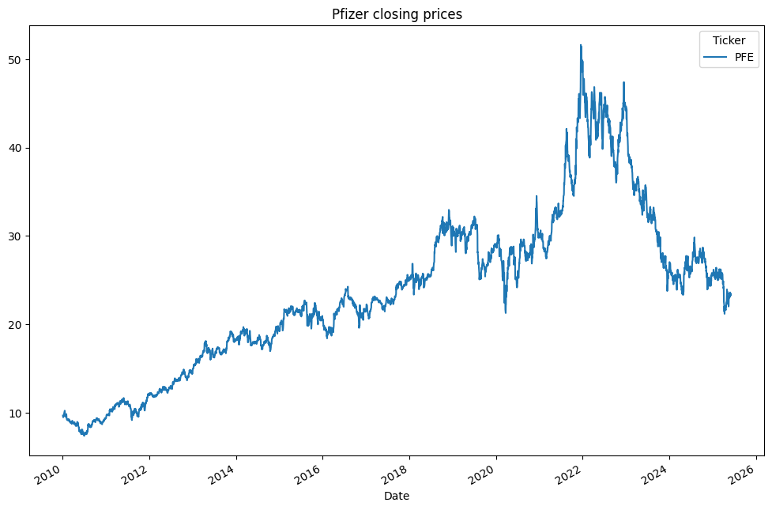
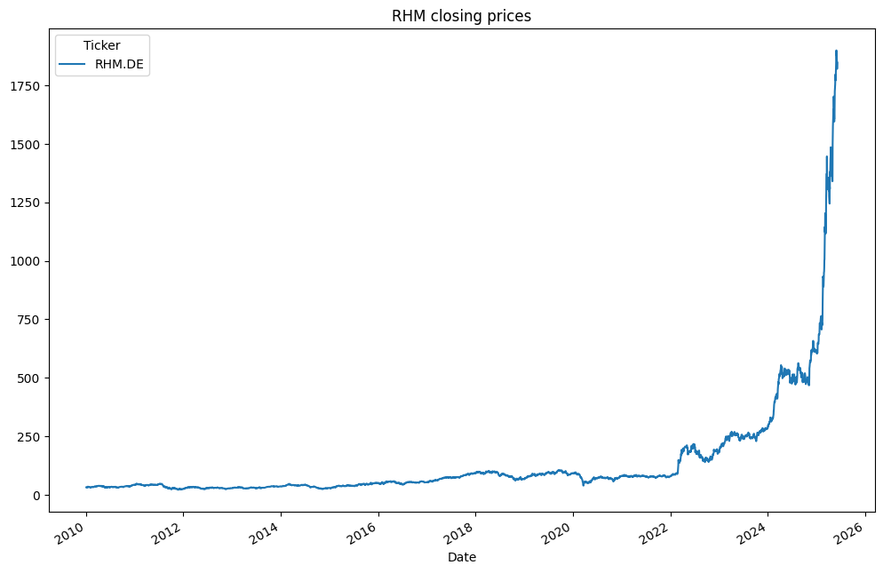
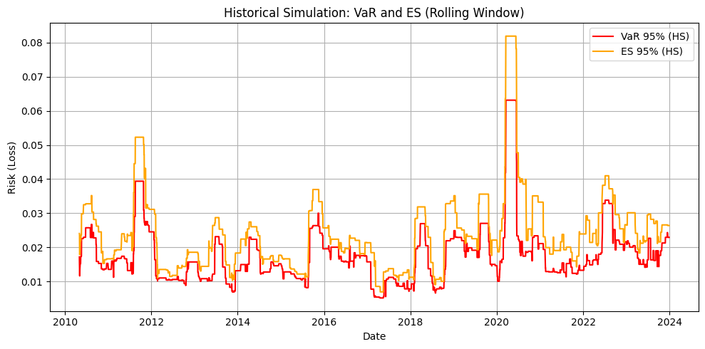
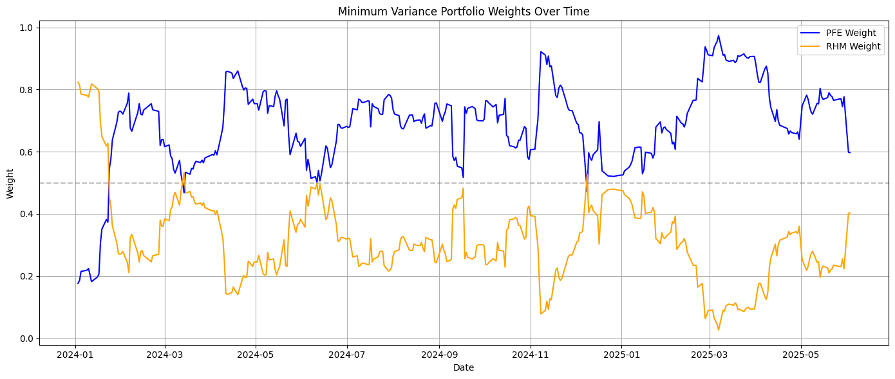
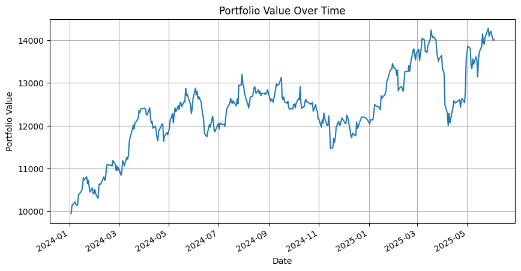
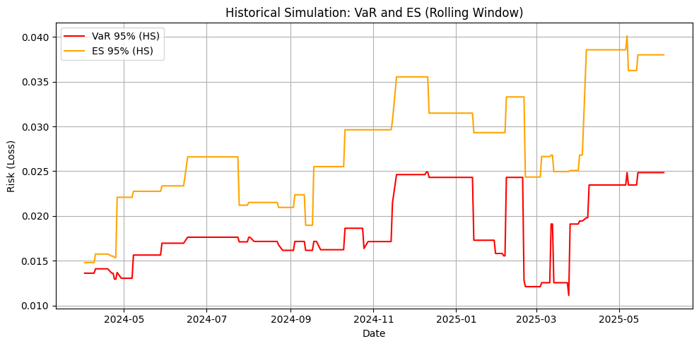
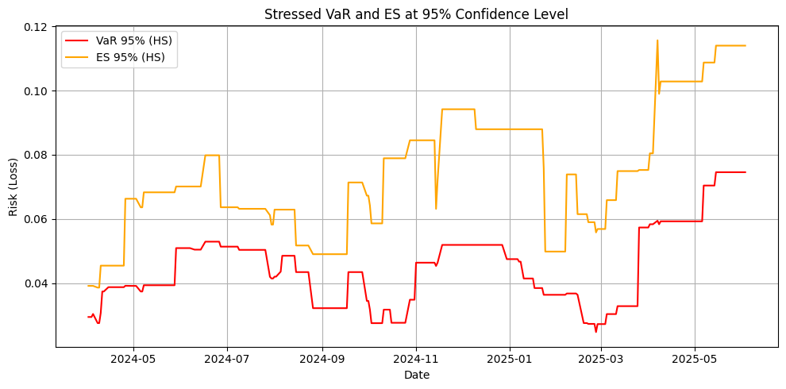
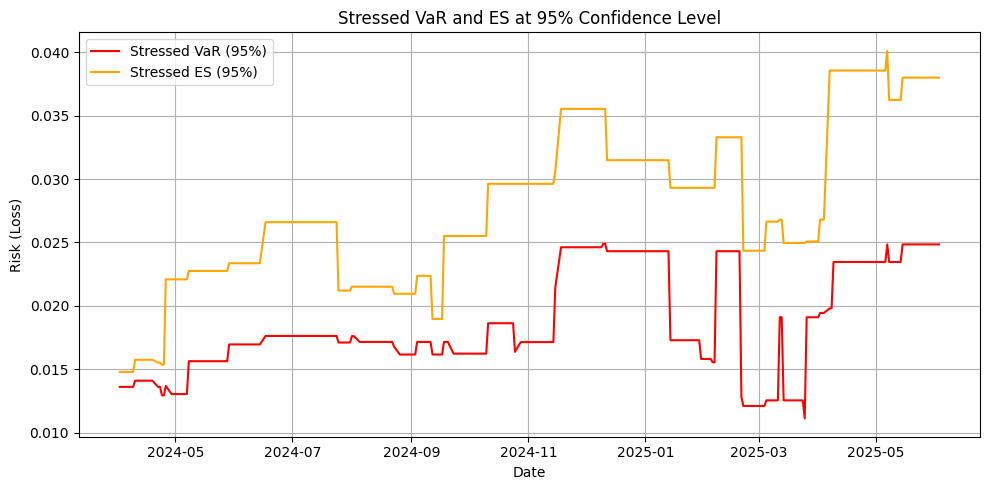
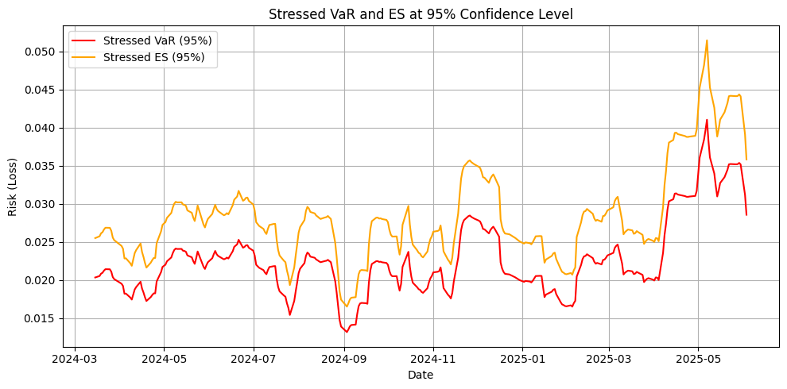

# Minimum Variance Portfolio Stress Testing

This project builds a two asset Minimum Variance Portfolio (MVP) that is rebalanced every day, and then tests how well different models can predict its risk, especially during periods of market stress.

The project was developed for the AI in Finance course of the Master's Degree in Artificial Intelligence at the University of Verona.

## Overview

The portfolio is made of two stocks:

- Pfizer (PFE): a pharmaceutical company that was strongly affected by the COVID-19 pandemic.
- Rheinmetall (RHM.DE): a German defense company that was strongly affected by the war in Ukraine and the rise in European defense spending.

These two assets were chosen because they react in very different ways to major market events, which makes them a good test case for a portfolio that must stay safe under stress.

The main steps of the project are:

1. Download daily prices from 2010 onward using the yfinance library.
2. Compute daily returns from closing prices.
3. Estimate a covariance matrix every day using a rolling window of recent returns.
4. Compute the Minimum Variance Portfolio weights for each day.
5. Estimate the daily Value at Risk (VaR) and Expected Shortfall (ES) at a 95 percent confidence level using several models.
6. Compare the models on a training period (2010 to 2023) and on an unseen test period (2024 to 2025).

## Data

Daily closing prices are downloaded from Yahoo Finance. Pfizer was stable until 2020, rose sharply during the pandemic and peaked at the end of 2021, then declined. Rheinmetall stayed flat until early 2022 and then rose very quickly after the invasion of Ukraine, with an even stronger rise from 2024.

| Pfizer closing prices | Rheinmetall closing prices |
|---|---|
|  |  |

## Method

### Portfolio construction

For each day, the covariance matrix of the two assets is computed on a rolling window of the last 20 days of returns. The weights that give the lowest possible portfolio variance, with all capital invested, are:

```
w_pfe = (var_rhm - cov) / (var_pfe + var_rhm - 2 * cov)
w_rhm = 1 - w_pfe
```

Because the window moves forward every day, the weights adapt quickly when the market changes.

### Risk models

- Normal (parametric) model: assumes returns follow a normal distribution.
- Historical simulation: uses the distribution of past returns in a rolling window.
- Stress amplification: gives more weight to returns from high volatility days, using a fixed volatility threshold.
- Stress amplification with z-score: detects stress days using a z-score of volatility instead of a fixed threshold.
- LSTM neural network: a model with one LSTM layer of 50 units, trained on the last 30 days of realized volatility to forecast the next day volatility, which is then used to compute VaR and ES.

The parameters of each model (window size, stress threshold, stress multiplier, z-score threshold) were chosen with a grid search on the training data.

### Evaluation metrics

- VaR violation rate: the percentage of days where the real loss was larger than the predicted VaR. With 95 percent confidence the ideal value is close to 5 percent. A higher value means the model underestimates risk, a lower value means it is too conservative.
- Actual ES compared to predicted ES: how close the predicted average extreme loss is to the real average loss on the days when VaR was exceeded.

## Results

### Training period (2010 to 2023)

The historical simulation already shows clear risk peaks in 2020 (COVID-19) and 2022 (war in Ukraine).



| Model | VaR violation rate (%) | Actual ES |
|---|---|---|
| Normal distribution | 0.00 | not available |
| Historical | 6.15 | 0.0235 |
| Stress amplification | 2.78 | 0.0205 |
| Stress amplification (z-score) | 6.15 | 0.0235 |
| LSTM | 4.24 | 0.0271 |

The LSTM is the model closest to the 5 percent target on the training data.

### Test period (2024 to 2025)

The test period was never used for training and includes the strong market shocks of 2025.

Portfolio weights: most of the capital goes to Pfizer, because Rheinmetall has been much more volatile since 2022. The weights change a lot over time, which shows how the portfolio reacts to new market conditions.



Portfolio value: starting from 10,000, the portfolio grew to around 14,000 by mid 2025.



Model comparison on the test period:

| Model | VaR violation rate (%) | Actual ES | Predicted ES |
|---|---|---|---|
| Normal distribution | 0.00 | not available | 0.0230 |
| Historical | 7.29 | 0.0266 | 0.0275 |
| Stress amplification | 0.69 | 0.0338 | 0.0737 |
| Stress amplification (z-score) | 7.29 | 0.0266 | 0.0275 |
| LSTM | 3.36 | 0.0329 | 0.0283 |

- The normal model had no violations at all, which means it is badly calibrated and too conservative.
- The historical model and the z-score stress model had a violation rate of 7.29 percent, which means they underestimated risk.
- The fixed threshold stress model had a violation rate of only 0.69 percent, but its predicted ES was more than double the actual ES, so it overestimated losses.
- The LSTM model gave the most balanced result, with a violation rate of 3.36 percent and a predicted ES close to the actual ES.

VaR and ES estimates of each model on the test period:

| Historical simulation | Stress amplification |
|---|---|
|  |  |

| Stress amplification with z-score | LSTM |
|---|---|
|  |  |

The LSTM estimates move smoothly and react to the volatility spike of April and May 2025, while the stress amplification model stays at very high levels for long periods.

## Conclusion

Simple models such as the normal and historical ones are easy to understand but do not adapt well when the market behaves differently from the past. Stress based models make the risk estimate more sensitive to turbulent periods, but they can become too conservative. The LSTM model gave the best balance between accuracy and robustness on unseen stressed data, which shows the value of adaptive, data driven models for risk management.

## Repository Structure

```
notebooks/
    mvp_stress_testing_lstm.ipynb   Full code, plots and analysis
docs/
    project_report.pdf              Written project report
    presentation_slides.pdf         Presentation slides
images/                             Charts taken from the notebook
requirements.txt                    Python packages needed to run the notebook
```

## How to Run

1. Install Python 3.10 or newer.
2. Install the required packages:

```bash
pip install -r requirements.txt
```

3. Start Jupyter and open the notebook:

```bash
jupyter notebook notebooks/mvp_stress_testing_lstm.ipynb
```

The notebook downloads the price data from Yahoo Finance when it runs, so an internet connection is needed. Results can change slightly from the ones above because new price data is added over time and because LSTM training is random.

## Authors

- Giacomo Lucato
- Silver Gjeka

University of Verona, Master's Degree in Artificial Intelligence, AI in Finance course.
